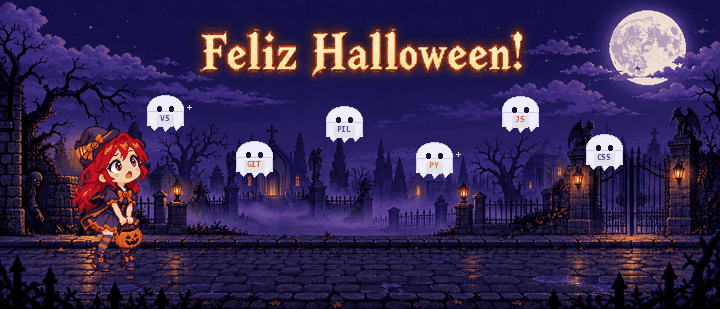

<div align="center">

# 🎃 Doces ou commits? 👻

### Uma aventura de Halloween entre fantasmas, mausoléus e linhas de código.



<sub>🎃 Feliz Halloween! 👀 Fantasmas flutuando e uma bruxa cruzando a lua devagar.</sub>

**É noite de Halloween...** 🌕🦇

</div>

---

## 🧟 Uma parada no caminho

A rua está escura e as luzes fracas mal iluminam o caminho. Um zumbi espreita pelas sombras enquanto fantasmas brancos flutuam pelo céu com siglas de programação: **VS**, **Git**, **PIL**, **Py**, **JS** e **CSS**. Ao fundo, mausoléus assombrados completam a paisagem. Perto da lua bonita e brilhante, uma bruxa passa lentamente em sua vassoura.

E lá estou eu, de potinho de abóbora na mão, parada por um instante e olhando para cima de olhos arregalados. Será que aqueles fantasmas também estão atrás de doces? 🍬

## 👻 Fantasmas da programação

| Fantasma | Poder especial |
|:--|:--|
| 💙 **VS Code** | Abre o portal onde as ideias viram código. |
| 🟠 **Git** | Guarda o histórico antes que algum bug lance uma maldição. |
| 🐍 **Python + Pillow** | Dá vida a imagens e automatiza pequenas bruxarias. |
| 🪦 **GitHub** | O mausoléu seguro para projetos e repositórios. |

## 🛠️ Como o GIF foi feito — passo a passo

O GIF é uma animação em loop feita para aparecer diretamente no README do GitHub. A frase **“Feliz Halloween!”** faz parte da arte de fundo; os fantasmas, a personagem e a bruxa são compostos em quadros animados por um script Python.

### 1. Planejamento da cena

Definimos o formato panorâmico para caber no perfil e a ação: a bonequinha ruiva fica com o potinho de abóbora, olha para o céu com expressão assustada, os fantasmas com siglas de programação pairam acima dela e a bruxa atravessa a lua lentamente. Mausoléus, portões, zumbi e luzes fracas formam o cenário.

### 2. Criação dos desenhos

Foram preparados três arquivos de imagem para a animação:

- `halloween-scene-title.png`: cenário panorâmico com o título **“Feliz Halloween!”** integrado ao céu;
- `ruivinha-surpresa.png`: personagem em pixel art com fundo transparente;
- `bruxa-voando.png`: bruxa em sua vassoura, também com fundo transparente.

O fundo foi editado para incluir a frase preservando o estilo pixel art. Os dois sprites transparentes permitem posicionar e mover a personagem e a bruxa separadamente do cenário.

### 3. Montagem dos quadros

O script [`make_animation.py`](./make_animation.py) usa **Python + Pillow**. Ele recorta as margens transparentes dos sprites, redimensiona os elementos e cria **80 quadros** no formato panorâmico de **720 × 309 px**. Em cada quadro, os fantasmas sobem e descem suavemente, a bruxa avança pela região da lua, e a personagem respira de leve, move o olhar e pisca. A frase fica parada no céu junto com o fundo.

### 4. Exportação e otimização

Os quadros são convertidos para uma paleta comum de cores e salvos como GIF em loop infinito. Depois, o FFmpeg reduz a taxa para cerca de 8 quadros por segundo, conserva até 128 cores e otimiza as diferenças entre quadros. Assim, o GIF final fica mais leve para carregar no GitHub.

### 5. Reproduzir a animação

Deixe o script e os três arquivos de imagem acima na mesma pasta. Instale as dependências e gere o GIF:

```bash
python -m pip install Pillow
python make_animation.py
```

Para repetir também a otimização usada no arquivo final, com o **FFmpeg** instalado, rode:

```bash
ffmpeg -y -i halloween-animation.gif \
  -filter_complex "fps=8,scale=720:-1:flags=lanczos,split[s0][s1];[s0]palettegen=max_colors=128:stats_mode=diff[p];[s1][p]paletteuse=dither=bayer:bayer_scale=4:diff_mode=rectangle" \
  -loop 0 halloween-animation-otimizado.gif
```

Depois, renomeie o arquivo otimizado para o nome esperado pelo README com `mv halloween-animation-otimizado.gif halloween-animation.gif`. Mantenha `README.md` e `halloween-animation.gif` juntos no repositório. O GitHub exibe GIFs animados em READMEs; CSS e JavaScript personalizados não são executados ali.

## 🕯️ Feitiço para coletar doces

```python
def noite_de_halloween():
    monstros = ["zumbi", "fantasma do Git", "bruxa da vassoura"]
    doces = 0

    for criatura in monstros:
        print(f"Encontrei {criatura}! Feliz Halloween! 🎃")
        doces += 1

    return f"Voltei com {doces} doces no potinho de abóbora! 🍬"

print(noite_de_halloween())
```

## 🌙 Status da missão

- **Missão:** encontrar doces sem se perder entre os mausoléus.
- **Companhia:** fantasmas de ferramentas e uma bruxa no céu.
- **Nível de coragem:** aumentando a cada commit.
- **Recompensa:** um potinho cheio de doces — e nenhum bug à solta. 🐛

<details>
<summary>🗝️ Abrir o grimório secreto</summary>

Você encontrou o feitiço escondido! Cada commit ilumina um pouco mais a rua — mas cuidado com os bugs que se fingem de doces. 👀

```text
🌕 Lua cheia + 🎃 potinho vazio + 💻 um bom commit = 🍬 missão concluída
```

</details>

---

<div align="center">

*Feito sob a luz da lua, entre um susto e outro.*

**Feliz Halloween!** 🎃👻🧙

</div>
